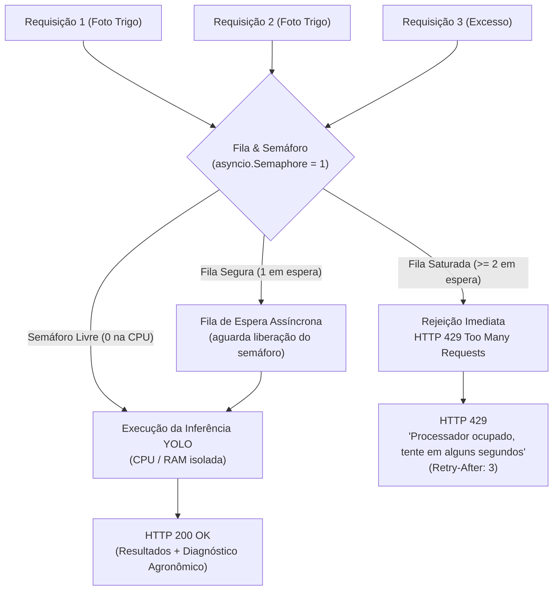

# Relatório Técnico: Proteção contra Sobrecarga no Motor de Inferência (Controle de Fila) — Sprint 9

- **Projeto:** SugarVision — Monitoramento Agrícola Inteligente de Trigo
- **Sprint:** Sprint 9
- **Responsável:** Membro 3 (IA A)
- **Data de Conclusão:** 29 de outubro de 2026
- **Status do Card:** Concluído com Sucesso

---

## 1. Contexto e Motivação do Problema

O motor de inteligência artificial do SugarVision utiliza o modelo **YOLOv8x** (`backend/best.pt`, ~130.5 MB em disco), calibrado para detecção e contagem de espigas de trigo (*Global Wheat Head Dataset 2021*).

Durante a inferência em imagens de alta resolução submetidas por operadores agrícolas ou drones de lavoura, a computação de tensores convolucionais e mapas de características consome picos substanciais de **memória RAM** (~600 MB a 1.2 GB por imagem) e demanda até **100% dos núcleos de CPU** da máquina hospedeira.

### Risco Operacional Mitigado:
Em versões anteriores, as requisições aos endpoints `/api/analyze-sample` e `/upload` despachavam predições diretamente para threads assíncronas sem limite de concorrência. Na ocorrência de múltiplos uploads ou requisições concorrentes:
1. Múltiplos tensores YOLO disputavam paralelamente CPU e memória;
2. Ocorria risco iminente de esgotamento de memória (*Out of Memory* - OOM Killer) e travamento (*crash*) do processo Uvicorn/FastAPI;
3. O healthcheck e as rotas de telemetria ficavam inacessíveis para o monitor do túnel Cloudflare.

---

## 2. Arquitetura da Solução Implementada

Para solucionar o problema de forma leve, resiliente e sem dependência de serviços externos pesados (como Redis ou RabbitMQ), foi implementado um controle assíncrono nativo em nível de aplicação com semáforo e fila segura.



### 2.1. Semáforo Singleton Global (`asyncio.Semaphore(1)`)
Em [`backend/app/services/ai_service.py`](file:///c:/Users/elisa/OneDrive/Documentos/sugarvision/backend/app/services/ai_service.py):
- Instanciação de `sem = asyncio.Semaphore(1)` no topo do módulo;
- Envolvimento do pipeline de inferência em bloco assíncrono:
  ```python
  async with sem:
      # Carga singleton do modelo e predição em threadpool
      total_deteccoes, detections, summary = await asyncio.to_thread(...)
  ```
- Garante estritamente que apenas uma imagem pesada de trigo seja processada por vez na CPU, eliminando picos multiplicativos de memória RAM.

### 2.2. Controle de Fila Segura e Rejeição Graciosa (HTTP 429)
- Variável de controle `_waiting_in_queue` com limite seguro configurável via variável de ambiente `MAX_INFERENCE_QUEUE` (padrão: `1`);
- Quando uma requisição chega enquanto o motor está ocupado (`sem.locked()`):
  - Se a fila de espera estiver dentro do limite seguro, ela é registrada e aguarda sua vez no semáforo;
  - Se a fila exceder o limite seguro, levanta `InferenceOverloadException` herdando de `HTTPException(status_code=429)`:
    - **Status Code:** `429 Too Many Requests`
    - **Corpo JSON:** `{"detail": "Processador ocupado, tente em alguns segundos"}`
    - **Header HTTP:** `Retry-After: 3`

### 2.3. Telemetria no Healthcheck (`GET /api/health`)
Em [`backend/app/services/health_service.py`](file:///c:/Users/elisa/OneDrive/Documentos/sugarvision/backend/app/services/health_service.py):
- O status da fila agora é exposto dinamicamente no payload de saúde da API:
  ```json
  "inference_queue": {
      "is_locked": false,
      "waiting_in_queue": 0,
      "max_safe_queue_size": 1
  }
  ```

---

## 3. Cobertura de Testes Automatizados

Foram adicionados 4 novos testes unitários e de integração na suíte [`backend/test_backend.py`](file:///c:/Users/elisa/OneDrive/Documentos/sugarvision/backend/test_backend.py) sob a classe `TestInferenceQueueConcurrency`:

| Teste | Objetivo | Resultado |
| :--- | :--- | :---: |
| **`test_56_telemetria_fila_inferencia_inicial`** | Valida que o semáforo inicia destravado (`is_locked=False`) e com fila zerada. | **PASS** |
| **`test_57_processamento_sequencial_com_semaforo`** | Dispara 2 predições simultâneas e valida execução estritamente sequencial sem sobreposição na CPU. | **PASS** |
| **`test_58_disparo_tres_requisicoes_simultaneas_com_protecao_429`** | **Critério do Card:** Dispara 3 requisições concorrentes de fotos de trigo. Comprova que Req 1 executa, Req 2 aguarda e Req 3 recebe `HTTP 429` com a mensagem `"Processador ocupado, tente em alguns segundos"` sem crash do servidor. | **PASS** |
| **`test_59_health_inclui_telemetria_da_fila`** | Valida se o endpoint `/api/health` retorna os dados de monitoramento da fila e do semáforo. | **PASS** |

---

## 4. Checklist Oficial do Card da Sprint 9

- [x] **Adicionar um semáforo ou trava assíncrona (`asyncio.Semaphore(1)` ou similar) no endpoint de predição do FastAPI para que o modelo processe apenas uma imagem pesada por vez.**
- [x] **Retornar uma mensagem de status amigável (`HTTP 429 — Processador ocupado, tente em alguns segundos`) caso a fila exceda o limite seguro.**
- [x] **Testar disparando 3 requisições simultâneas de fotos de trigo para comprovar que o servidor não sofre crash por falta de memória.**
- [x] **Abrir o arquivo `backend/app/services/ai_service.py`.**
- [x] **Criar no topo: `sem = asyncio.Semaphore(1)`.**
- [x] **Envolver a execução da inferência com `async with sem:` para garantir que apenas uma imagem pesada de trigo seja processada por vez na CPU.**
